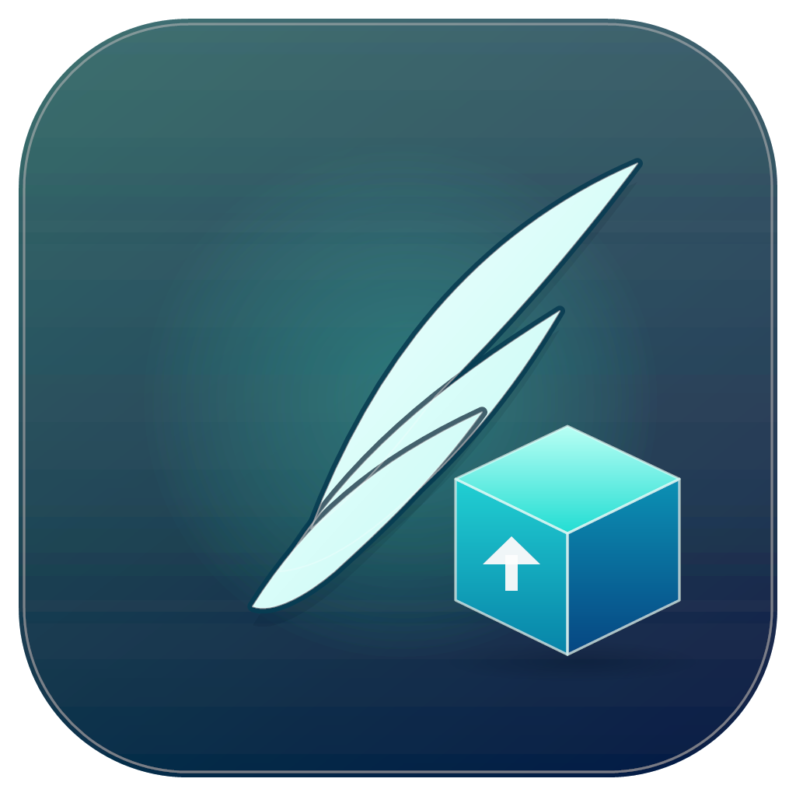

# Asa · winget fácil

Uma interface leve e simples para o **winget** no Windows, feita em **C# com WinUI 3**.

O Asa permite buscar programas no catálogo oficial, instalar com um clique, ver o que já está
instalado e escolher quais atualizações aplicar — sem abrir o terminal.

## Recursos

- **Descobrir** — busca no catálogo do winget com sugestões e debounce.
- **Instalados** — lista os programas reconhecidos pelo winget, com filtro local e seleção em massa.
- **Atualizações** — mostra apenas os pacotes com atualização pendente e permite atualizar em lote.
- **Fila global** — instalações e atualizações são executadas uma por vez, com painel de atividade e log detalhado.
- **Proteção ao atualizar** — antes de atualizar, detecta aplicativos, processos e serviços que estejam usando o pacote e só fecha o que estiver aberto depois da sua confirmação.
- **Instalação silenciosa** — ativada por padrão e persistida entre sessões.
- **Execução elevada** — o Asa pede permissão de administrador ao abrir (UAC), assim as instalações e
  atualizações do winget não interrompem o fluxo com novas confirmações.
- **Visual nativo** — tema claro/escuro, Mica e barra de título personalizada.

## Requisitos

- Windows 10 versão 1809 (build 17763) ou superior, x64.
- [App Installer](https://aka.ms/getwinget) com o `winget` disponível.
- Para compilar: [.NET SDK 8.0](https://dotnet.microsoft.com/download/dotnet/8.0).

## Compilar e executar

```powershell
dotnet build -c Debug -p:Platform=x64
.\bin\x64\Debug\net8.0-windows10.0.19041.0\Asa.exe
```

## Publicar uma versão portátil

**Opção 1 — autossuficiente (recomendada).** Não exige runtimes instalados no destino:

```powershell
dotnet publish -c Release -p:Platform=x64 -p:RuntimeIdentifier=win-x64 `
  -p:SelfContained=true -p:WindowsAppSDKSelfContained=true -o publish
```

Depois, execute `publish\Asa.exe`. A pasta `publish` pode ser copiada para outro computador x64
com Windows 10 1809+ e o winget instalado. Ela tem cerca de 200 MB porque inclui o runtime do
.NET e os componentes do Windows App SDK.

**Opção 2 — enxuta.** Gera uma pasta de cerca de 37 MB, mas exige o
[.NET Desktop Runtime 8](https://dotnet.microsoft.com/download/dotnet/8.0) e o
[Windows App Runtime 1.8](https://learn.microsoft.com/windows/apps/windows-app-sdk/downloads)
instalados no computador de destino:

```powershell
dotnet publish -c Release -p:Platform=x64 -p:RuntimeIdentifier=win-x64 `
  -p:SelfContained=false -p:WindowsAppSDKSelfContained=false -o publish-enxuto
```

## Como funciona

O Asa é um cliente fino do `winget.exe`:

- A lista de instalados e as atualizações vêm de `winget list --count 1000`.
- A busca usa `winget search --query <termo> --count 40`.
- Instalações e atualizações usam `--id`, `--exact`, `--accept-package-agreements`,
  `--accept-source-agreements` e `--disable-interactivity` (além de `--silent` quando ativado).
  Atualizações também usam `--include-unknown`, necessário para pacotes cuja versão instalada
  o winget não consegue determinar.
- A saída tabular é interpretada a partir da posição das colunas no cabeçalho, portanto funciona
  com cabeçalhos localizados (por exemplo, `Nome`, `ID`, `Versão`, `Disponível` e `Origem`).
- Quando o winget não consegue determinar a versão instalada de um pacote, o Asa tenta confirmá-la
  localmente, nesta ordem: registro de desinstalação do Windows (`DisplayVersion`), metadados dos
  executáveis da instalação (`ProductVersion`/`FileVersion`) e chave `App Paths` do registro. Só
  vale quando existe correspondência de alta confiança: o nome do programa (normalizado — sem
  acentos, sem caixa e sem sufixos de arquitetura) precisa ser igual ao nome do pacote. Sem isso
  a versão continua "Desconhecida" e a atualização segue possível com `--include-unknown`.
- Versões genéricas lidas de metadados de arquivo (0.0.0.0, 1.0.0.0 e afins) não contam como
  confirmação: a versão continua visível, mas a atualização permanece disponível. Isso vale para
  todas as fontes de metadados de arquivo (metadados do executável da instalação e executável
  apontado pela chave `App Paths`); versões vindas do registro de desinstalação são comparadas
  normalmente.
- Quando a versão detectada é da mesma release da versão disponível no catálogo, o Asa não oferece
  uma atualização desnecessária: o pacote sai de Atualizações e aparece como "Em dia", com a
  versão marcada por um pequeno escudo discreto ao lado. Versão e origem da verificação
  (arquivo do programa, registro do Windows etc.) aparecem no tooltip da versão.
- Antes de cada atualização, o Asa usa o Restart Manager do Windows e a pasta real do pacote
  (MSIX ou registro de desinstalação) para descobrir processos, extensões e serviços em uso.
  Quando o instalador não informa a pasta, a busca é feita dinamicamente pelo nome do pacote —
  nunca por uma lista fixa de processos.
- Com sua confirmação, o Asa tenta fechar o aplicativo normalmente e, se necessário, força o
  encerramento; serviços parados são reiniciados ao final. O Explorer é reiniciado quando
  necessário. Sem confirmação, somente aquela atualização é ignorada e a fila continua.

Preferências ficam em `%LOCALAPPDATA%\Asa\settings.json`. Se ocorrer uma falha inesperada, os
detalhes são gravados em `%LOCALAPPDATA%\Asa\crash.log`.

## Estrutura do projeto

```
Models/        Modelos de pacote e operação
Services/      Integração com winget, parser, fila de operações e preferências
ViewModels/    Estado das páginas e linhas de pacote
Views/         Páginas Descobrir, Instalados, Atualizações e Configurações
Styles/        Tema, estilos e template compartilhado das linhas
Helpers/       Utilitários de binding e comandos
```

## Observações

- O Asa é iniciado com privilégios de administrador (definido em `app.manifest`). O Windows mostra
  um prompt do UAC a cada abertura; depois disso, instalações e atualizações rodam sem pedir
  permissão de novo. Se preferir não ver o prompt, crie uma tarefa no Agendador de Tarefas com
  "Executar com privilégios mais altos" apontando para `Asa.exe`.
- Alguns pacotes MSIX (por exemplo, Terminal do Windows e Claude) só trocam de versão quando o
  aplicativo, seus serviços ou extensões do Explorer não estão em uso. Se o winget informar
  sucesso mas a atualização continuar na lista, feche o aplicativo, reinicie o Explorer (ou o
  Windows) e tente novamente — o Asa avisa quando a versão não muda.
- Quando o winget não consegue determinar a versão instalada (por exemplo, Epson Scan 2), o Asa
  tenta confirmar a versão no registro de desinstalação e nos metadados do executável do programa.
  Se a correspondência não for confiável, a versão continua "Desconhecida", o pacote permanece em
  Atualizações e a atualização é feita com `--include-unknown` — o Asa não trata esse caso como
  falha. Quando a versão detectada é da mesma release da versão disponível (por exemplo,
  `6.7.81.39976` e `6.7.81.0`), o pacote sai de Atualizações e passa a aparecer como "Em dia".
  Versões genéricas de arquivo (`0.0.0.0`, `1.0.0.0`) são exibidas, mas não dispensam a
  atualização: nesses casos o pacote continua em Atualizações.
- Alguns instaladores ainda podem exibir uma janela própria ou pedir permissão do Windows.
- O winget precisa estar atualizado e com acesso ao catálogo para buscar e atualizar.
- Projeto independente, sem vínculo com a Microsoft.
